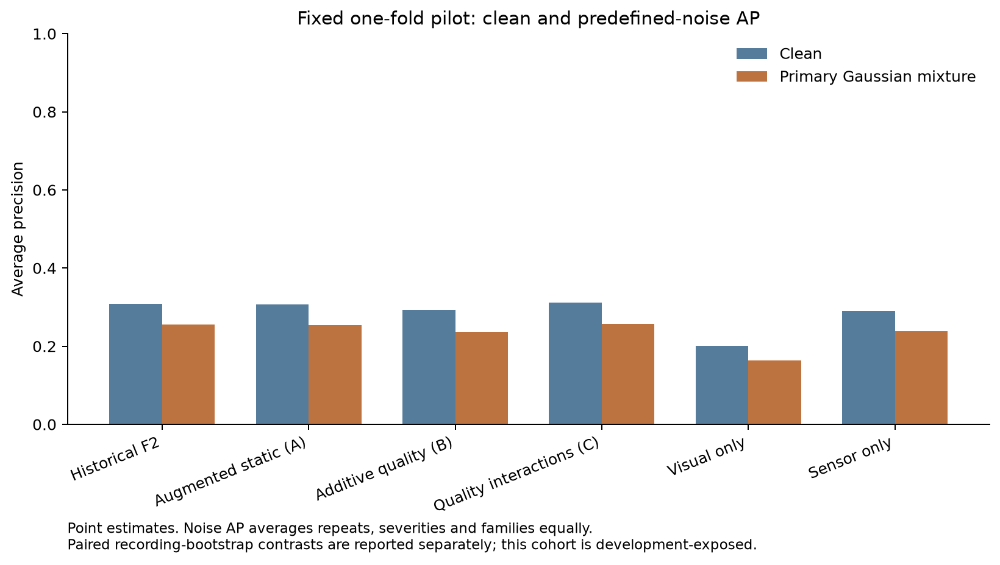
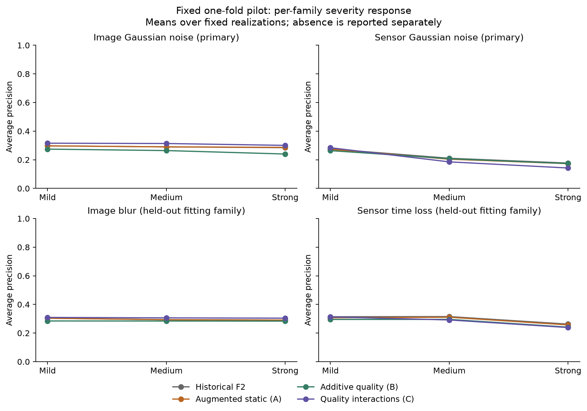

# Inconclusive — completed controlled adaptive-fusion pilot

The quality-interaction model did not demonstrate a reliable primary improvement over augmentation-matched static fusion. Its primary AP was 0.257009 versus 0.253996: difference **+0.003012**, paired 95% interval **[-0.026711, +0.032165]**. This interval includes both benefit and deterioration. Do not interpret the small positive point estimate as established superiority.

The predeclared one-fold pilot is complete: **753 actions, 77 failures, 26 recordings, 34 realizations per action**, giving 25,602 identified action-realization rows. All 34 prediction tables have exact matching coverage; failed cases = 0. The 753 both-absent rows are explicitly unavailable, not discarded failures. The other four outer folds remain untested because the training-only runtime admission locked fold_01 before assessment.

## Comparison

| Model | Clean AP | Primary noise AP | Image noise AP | Sensor noise AP | Blur AP | Time-loss AP |
| --- | --- | --- | --- | --- | --- | --- |
| Historical clean-trained F2 | 0.307929 | 0.255937 | 0.290750 | 0.221124 | 0.295987 | 0.297046 |
| A: Augmented static | 0.307397 | 0.253996 | 0.291350 | 0.216642 | 0.295744 | 0.291400 |
| B: Additive quality | 0.292965 | 0.237360 | 0.259651 | 0.215069 | 0.283978 | 0.277316 |
| C: Quality interactions | 0.312168 | 0.257009 | 0.309977 | 0.204040 | 0.306400 | 0.280845 |
| Visual only | 0.200401 | 0.162982 | 0.125563 | 0.200401 | 0.179632 | 0.200401 |
| Sensor only | 0.290531 | 0.239087 | 0.290531 | 0.187644 | 0.290531 | 0.270442 |

Primary AP averages separately calculated AP across repeats, severities, the two Gaussian families and matched folds with equal weights. Repeated corruptions are not pooled as independent subjects, and probabilities are not averaged before AP. Pooled outer-fold AP is separately identified in per_condition_metrics.csv; with one fold it equals the corresponding fold AP. The table's family values average the prescribed severities and repeats.

## What augmentation, quality and interactions contributed

| Contrast | AP difference | 95% paired interval |
| --- | --- | --- |
| interaction_minus_augmented_static_PRIMARY | +0.003012 | [-0.026711, +0.032165] |
| interaction_minus_additive_PRIMARY | +0.019649 | [-0.000813, +0.038743] |
| augmented_static_minus_historical_PRIMARY | -0.001941 | [-0.005019, +0.001816] |
| quality_additive_minus_static_augmented_PRIMARY | -0.016636 | [-0.030676, -0.002429] |
| quality_interaction_minus_static_augmented_CLEAN | +0.004771 | [-0.034258, +0.044544] |
| quality_interaction_minus_historical_static_CLEAN | +0.004239 | [-0.032954, +0.043717] |
| quality_additive_minus_static_augmented_CLEAN | -0.014432 | [-0.029596, -0.000235] |

Augmentation alone showed no demonstrated primary benefit over historical clean-trained F2. Adding quality features without interactions reduced primary AP by 0.016636; its secondary interval is below zero. Interactions recovered performance relative to the additive model, but their +0.019649 contrast still includes zero. Consequently, these data do not establish that input-dependent modality coefficients improve the primary noise mixture.

For C versus A, average image-noise AP increased by 0.018627 and blur AP by 0.010656. Sensor-noise AP decreased by 0.012603 and time-loss AP by 0.010555. The worst family was sensor noise: C achieved 0.204040, below A's 0.216642. At strong sensor noise, C-A was -0.030310 with interval [-0.081866,+0.030406]. All individual C-A severity intervals include zero; these unadjusted secondary results describe the observed tradeoff, not universal superiority or established fault-specific effects.

C's clean AP increased by 0.004771 versus A and 0.004239 versus historical F2. Both clean intervals include meaningful losses: **no demonstrated absence of clean-performance cost** under the conservative zero-degradation margin. B's clean AP was lower than A's by 0.014432 (secondary interval [-0.029596,-0.000235]).

Unimodal outputs are included for context. Declared image absence routes every fusion model to the same sensor probability (AP 0.290531); sensor absence routes to the visual probability (AP 0.200401). Both absent produces unavailable/abstain. These fallback results are separate from the primary noise mixture.

## Fits, uncertainty and verification

Frozen 16-frame CNN and sensor branches, their original preprocessing, normalizers, calibrators and fitted components were retained. Three fusion models used exactly 3,777 inner-OOF parent actions and 11,331 rows, with per-action weights 0.5 clean, 0.25 image fault and 0.25 sensor fault. Each corrupted OOF prediction used the matching inner branch fit; assessment recordings were excluded from training, scales and quality normalization. Raw image pixels/native sensor signals were corrupted. Quality uses eight locked observable proxies, without fault identity, severity, seed, label or pristine counterpart as predictor inputs. All new components were locked before assessment. No branch training, tuning or new calibration occurred.

The 2,000 paired recording-cluster bootstrap draws were all valid, with zero invalid draws. Models, actions and realizations remain paired within recordings. Intervals condition on fixed fits and corruption realizations; secondary intervals are unadjusted. Additive-quality contrast was declared before assessment and uses the identical recording draw hash.

Fourteen focused tests passed. Independent saved-table recalculation reproduced 196 AP values and the hierarchical primary contrast. A separate arithmetic verifier replayed 70,029 new fusion probabilities from saved components and input columns, checked all 34 prediction files, training weights/normalization, source/configuration/clock locks, 296 raw-path metadata identities and protected previous artifact hashes. All passed. These are independent code-path checks, not external scientific review. See checks/completion_integrity.json and checks/independent_recalculation.json.

## Runtime and preservation

Automated inference, evaluation and the initial reports finished **22 October 2026 at 12:06 Berlin time**. Elapsed time to those results was 18.82 hours, including initial audit allowance and an interruption. Approximate observed active scientific execution was 12.94 hours; exact termination time of the initial worker is unavailable. Training-input generation and fitting took 3.36 hours; resumed assessment including cache replay took 3.90 hours. Final independent review was performed later, within the original 24-hour window.

The initial worker was absent after the interrupted chat session; the exact termination cause was not established. All 34 partial tables were preserved under provenance/interruption_01. Resume admission validated 29,907 cached arrays and the original locks, then reused the saved models without retraining or changing settings, seeds, folds or deadlines. The stale periodic checkpoint of 751 in progress.json is superseded by predictions/fold_01/complete.json and verified coverage of all 753 actions.

CPU only, eight threads on cores 4–11; no GPU used. Maximum observed process RSS across both sessions was 1.723 GiB. Study storage before final repacking was 0.578 GiB, far below 30 GiB. Exact resource observations and immutable deadline are in provenance/final_runtime.json and config/clock.json. Existing backbone workflow was not interrupted or restarted. Protected encoder/noise artifacts and governing scientific source identities are unchanged. No packages, datasets or weights were installed or downloaded; no additional experiment was launched.

## Limits and next decision

This is an exploratory, development-exposed **one-fold completed-action classification pilot**, not independent validation, online detection or an early-warning result. The cohort and earlier scores were already exposed to development. Held-out blur and time loss are excluded from augmentation fitting but remain part of the same dataset. Quality statistics are proxies; interaction coefficients are input-dependent coefficients, not trust percentages or causal importance.

DATA_AUDIT.md documents exact native labels, known force/torque and hardware issues, eligibility, frame sampling and sensor alignment. The bounded checks passed without relabeling or changing the cohort. Sixteen deterministic training examples have contact sheets and sensor summaries; assistant visual observations cover four, and human semantic adjudication remains outstanding. Finite sensor values do not establish physical validity. Four outer folds and independent-recording validation remain incomplete.

**Recommended next decision: retain historical F2 as the working baseline; do not adopt the adaptive model on this pilot evidence.** Any further confirmation would require separate authorization and broader matched coverage. No new experiment is launched here.

## Directly identified artifacts and recalculation

- [Prediction index with paths, SHA256 and coverage](comparison/coverage_and_prediction_index.csv)
- [Clean predictions](predictions/fold_01/clean/clean/repeat_00/predictions.csv)
- [Example corrupted table: strong sensor Gaussian, repeat 1](predictions/fold_01/sensor_noise/strong/repeat_01/predictions.csv)
- [All per-condition metrics, including AUROC, Brier and fixed-threshold confusion counts](comparison/per_condition_metrics.csv)
- [Paired intervals](comparison/paired_intervals.csv) and [additive-quality contrast](comparison/additive_quality_contribution.csv)
- [Saved fusion components](fusion_fits/fold_01/components.json) and [identified OOF training inputs](fusion_fits/fold_01/identified_OOF_training_inputs.csv)
- [Locked protocol](PROTOCOL.md), [resolved configuration](config/resolved_config.json), [quality definitions](config/quality_definitions.json), [native audit](DATA_AUDIT.md)
- [Runtime](provenance/final_runtime.json), [review ZIP](REVIEW_PACKAGE.zip), [package verification and SHA256](checks/package_verification.json)

Recalculate from saved prediction tables, from the repository root:

```bash
ma_thesis_env/bin/python -B 00_experiments/adaptive_fusion_robustness/code/recalculate.py
ma_thesis_env/bin/python -B 00_experiments/adaptive_fusion_robustness/results/run_01/checks/verify_completed_study.py
ma_thesis_env/bin/python -B 00_experiments/adaptive_fusion_robustness/results/run_01/checks/supplementary_quality_contrast.py
```




