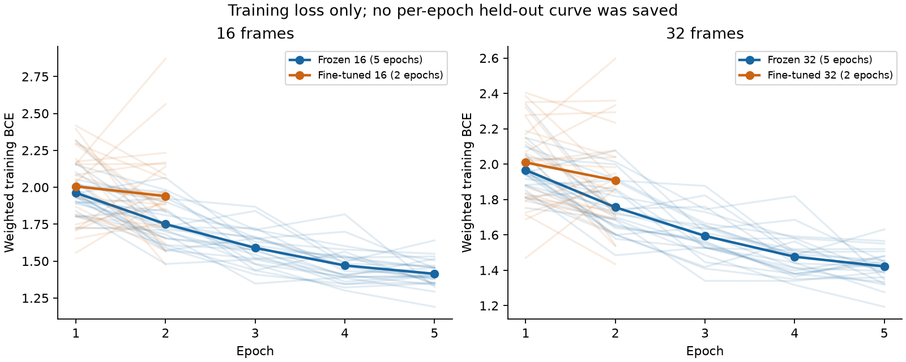
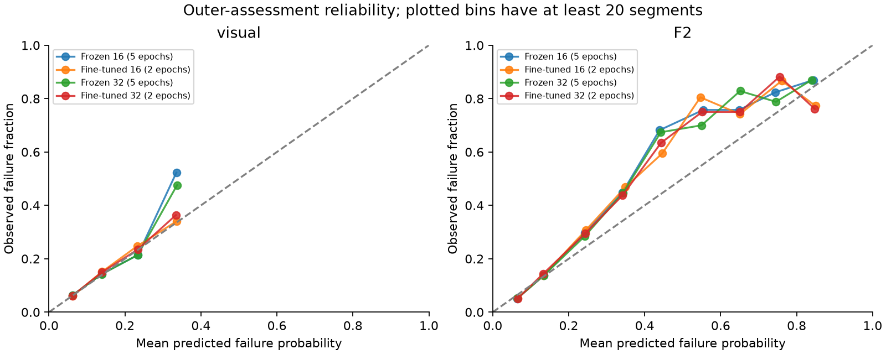
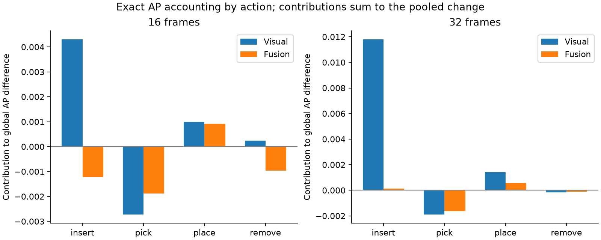

# Why did fine-tuning not improve fusion AP?

Analysis completed on 22 October 2026. Source study: `../run_01_two_epoch_finetuning/`. All new calculations are exploratory diagnostics of already assessed data. This report does not execute a follow-up experiment.

## 1. What the completed results establish

The statement “fine-tuning did not improve anything” is too broad. Image-only ranking and Brier score improve slightly in the pooled assessment, while fusion AP is slightly lower. These are point estimates, not a demonstrated universal advantage or disadvantage.

| Recipe | Image AP | Image Brier | Fusion AP | Fusion Brier | Fusion TP / FP at 0.5 |
|---|---:|---:|---:|---:|---:|
| Frozen16, 5 epochs | 0.221644 | 0.095350 | 0.440680 | 0.079623 | 102 / 31 |
| Fine-tuned16, 2 epochs | 0.224466 | 0.094749 | 0.437521 | 0.079709 | 105 / 30 |
| Frozen32, 5 epochs | 0.219427 | 0.095456 | 0.439584 | 0.079700 | 100 / 31 |
| Fine-tuned32, 2 epochs | 0.230609 | 0.094660 | 0.438566 | 0.079752 | 103 / 31 |

AP measures the ordering of failures across decision thresholds; higher is better. Brier measures squared probability error; lower is better, but it combines calibration and discrimination rather than measuring calibration alone. TP and FP refer to the original fixed 0.5 threshold. A small improvement at one threshold can coexist with lower AP.

All recipes use the same 4,530 held-out segments, 509 failures, 148 recordings and five outer folds. Shared sensor AP is 0.420803. All 72 condition/branch/scope metric rows were reconciled with the original AP, AUROC and Brier values. The original predeclared primary contrast is fine-tuned16 minus frozen16 fusion AP: **-0.003159, 95% recording-cluster interval [-0.012573, +0.008052]**. It includes zero. No new uncertainty interval was invented for the exploratory fine-tuned32 versus frozen32 difference.

Evidence: [assessment metrics](tables/assessment_metrics.csv), [paired changes](tables/paired_AP_and_Brier_changes.csv), [original predeclared intervals](tables/original_predeclared_intervals.csv).

## 2. Strongest new clue: the image improvement is inconsistent between OOF training and assessment

F2 learns how to combine image and sensor probabilities from inner out-of-fold predictions. Each OOF prediction comes from a branch that did not train or calibrate on that recording. F2 subsequently assesses a separately fitted outer branch on unseen outer recordings. These are different fitted models, data subsets and training sizes.

For **32 frames**, fine-tuning reduces visual AP in **all five OOF banks** used to train F2. For **16 frames**, it reduces OOF visual AP in **three of five banks**. Outer-assessment visual AP improves in three of five folds for each frame count. Thus the pooled image-only gain does not describe a consistent improvement in the inputs available when fusion learns its combination.

| Outer fold | 16-frame OOF image AP change | 16-frame assessment image AP change | 32-frame OOF image AP change | 32-frame assessment image AP change |
|---|---:|---:|---:|---:|
| 1 | -0.019662 | +0.035066 | -0.020925 | +0.051522 |
| 2 | +0.007260 | -0.024167 | -0.000903 | -0.007249 |
| 3 | -0.021043 | +0.020620 | -0.021874 | +0.017284 |
| 4 | +0.002457 | +0.002484 | -0.003108 | +0.047751 |
| 5 | -0.032116 | -0.034494 | -0.010091 | -0.026288 |

The fitted image coefficient is lower after fine-tuning in folds 1, 3 and 5 for both frame counts. For example, in fold 1 it changes from 3.160 to 2.115 at 16 frames and 3.222 to 1.965 at 32 frames. However, F2 learns conditional utility given sensors, not image AP alone. Different score scales and correlations also affect the coefficients; they are not causal modality percentages.

**Supported interpretation:** fine-tuning does not provide consistently stronger image inputs across the fitted stages of this workflow. This is compatible with fusion learning less image influence in some folds. **Not established:** that the OOF/assessment discrepancy causes the pooled AP difference, or that it proves distribution shift, leakage or overfitting. OOF versus outer assessment is not a same-model training/validation loss comparison, and the OOF banks across outer folds overlap heavily.

Evidence: [matched OOF/assessment changes](tables/OOF_to_assessment_pair_changes.csv), [OOF/assessment metrics and support](tables/OOF_vs_assessment_visual_metrics.csv), [fusion coefficients and score spreads](tables/fusion_coefficients_and_score_spread.csv).

## 3. Fine-tuned images do not consistently rescue additional sensor mistakes

We ranked segments within each outer fold and selected a fixed top 10% or 20% for each branch. These label-blind ranking budgets were specified in the diagnostic configuration before the calculations; they are explanatory operating points, not selected deployment thresholds. Ceiling rounding selects 455 and 908 segments respectively. The sensor ranking is identical across conditions.

Here “additional” means a true failure selected by fusion that is outside the sensor model's selected set at the same budget.

| Frames | Budget | Frozen fusion captured failures | Fine-tuned fusion captured failures | Additional beyond sensor: frozen | Additional beyond sensor: fine-tuned |
|---|---:|---:|---:|---:|---:|
| 16 | Top 10% | 220 | 218 | 14 | 6 |
| 32 | Top 10% | 217 | 217 | 11 | 5 |
| 16 | Top 20% | 286 | 290 | 16 | 16 |
| 32 | Top 20% | 289 | 292 | 15 | 18 |

The sensor captures 217 failures at the 10% budget and 289 at the 20% budget. Fine-tuning offers fewer extra rescues near the top 10%, but there are modest gains at 20%. This rules out a blanket interpretation that fine-tuning is worse at every operating point or that images contribute nothing.

Image-only extra rescues are also mixed. At 32 frames they increase from 41 to 47 at 10%, but decrease from 66 to 64 at 20%. At 16 frames they change from 45 to 43 and from 55 to 60 respectively. The evidence does not support claiming all visual improvement is redundant with sensor information. It supports **inconsistent transfer of visual changes into useful fused ranking**.

At the original 0.5 threshold, fusion gains a net three detected failures for both frame counts, with one fewer false positive at 16 frames and unchanged false positives at 32 frames. Those are descriptive changes among the same observed samples, not independent statistical tests.

Evidence: [fixed-budget complementarity](tables/fixed_budget_complementarity.csv), [threshold error transitions](tables/threshold_error_transitions.csv), [sensor-score strata](tables/sensor_score_strata.csv).

## 4. Learning dynamics warrant investigation; insufficient epochs remain unproved

The saved loss is class-weighted training binary cross-entropy, accumulated during training with dropout. Compare the **first two epochs of both recipes** before considering the longer frozen run:

| Recipe | Fits | Mean epoch 1 loss | Mean epoch 2 loss | Fits improving from epoch 1 to 2 |
|---|---:|---:|---:|---:|
| Frozen16 | 25 | 1.962444 | 1.750924 | 22 / 25 |
| Fine-tuned16 | 25 | 2.006159 | 1.940454 | 14 / 25 |
| Frozen32 | 25 | 1.966463 | 1.756062 | 22 / 25 |
| Fine-tuned32 | 25 | 2.009602 | 1.908334 | 15 / 25 |

Fine-tuning has less consistent training-loss reduction during the observed two epochs. This is a reason to investigate joint optimisation, head adaptation, learning rates and stopping duration. It is not evidence that additional epochs will necessarily help. These 25 fits have overlapping training records and must not be treated as 25 independent trials.

Frozen recipes train the same classifier head for five epochs. Fine-tuned recipes train the head plus 8,388,608 final-stage CNN parameters for two epochs. Head learning rate is 1e-3, CNN-stage rate 1e-5, with AdamW, weight decay 1e-3 and gradient clipping at 1. Mean pooling, head architecture, fixed G-derived normalisation and backbone evaluation mode remain as implemented. No new temporal transformer is involved.

The inspected source trains only the final CNN stage. All 100 saved fit-check records report changed head parameters, and all 50 fine-tuned records report changes to the intended five final-stage convolution tensors, finite gradients and unchanged earlier backbone/normalisation buffers. Their complete manifests match the recorded lineage checksums. This makes “the backbone was accidentally left frozen” an unsupported leading explanation. This diagnostic did not reload weights or rerun those model checks; it inspected the original recorded evidence and source.

No per-epoch held-out performance curves are available in this packet. C was used to fit calibration and cannot be relabelled as untouched validation for retrospective epoch selection. Epoch-2 frozen assessment AP cannot be reconstructed from its five-epoch final predictions. The saved evidence does not distinguish underfitting, overfitting, feature drift or learning-rate problems.

Evidence: [all learning curves](tables/all_learning_curves.csv), [matched summary](tables/learning_curve_summary.csv), [fit/update checks](tables/fit_learning_and_update_checks.csv), source [training.py](../run_01_two_epoch_finetuning/source/training.py), [visual_model.py](../run_01_two_epoch_finetuning/source/visual_model.py), [fusion.py](../run_01_two_epoch_finetuning/source/fusion.py).

## 5. Calibration changes score scales, but is not established as the cause

Every visual calibrator has a positive slope. Its arithmetic reproduces the saved held-out visual probabilities, and visual AP is unchanged by calibration **within every individual fit**. Thus calibration has not reversed or damaged within-fit visual ranking. Different calibration functions across folds can still affect pooled ranking and the values consumed by F2.

Fine-tuned image Brier is lower overall at both frame counts. Fusion Brier is only slightly higher: +0.000086 at 16 frames and +0.000052 at 32 frames. This does not support a broad claim that fine-tuning simply destroyed probability quality. Calibration sets contain 40–93 failures per fit; their apparent calibrated Brier is supplied for audit, but it is measured on data used to fit the calibrator.

Visual calibration slopes vary across fits, and coefficients cannot be interpreted without raw-score scale. Outer-assessment sensor score terms have a larger standard deviation than image score terms in every fitted F2. This describes how these fitted scores vary; it does not show causal dominance or quantify a modality's percentage importance.

The exact algebraic change in fusion logits was decomposed into changed image probabilities, changed image coefficient, changed sensor coefficient and intercept. Reconstruction error is below 1e-11. This verifies that both branch changes and F2 refitting matter to the numerical score change. It is an identity for existing predictions, not a causal ablation, a new fusion variant or a direct decomposition of AP.

For readability, plotted bins require at least 20 segments. All bins, including sparse and empty bins, remain in the CSV. No interval or significance claim is based on the appearance of this plot.

Evidence: [calibration by fit](tables/calibration_by_fit.csv), [reliability bins](tables/reliability_bins.csv), [score spreads](tables/fusion_coefficients_and_score_spread.csv), [exact logit accounting](tables/exact_fusion_logit_change_decomposition.csv).

## 6. The effects differ by action and recording

AP is not additive across ordinary subgroup APs. To account for the exact pooled change, each positive segment is assigned its contribution to global AP, with complete tied-score threshold groups respected. Contributions are then summed by action or recording.

| Action | Segments | Failures | 16-frame image AP contribution change | 16-frame fusion AP contribution change | 32-frame image AP contribution change | 32-frame fusion AP contribution change |
|---|---:|---:|---:|---:|---:|---:|
| insert | 1,156 | 243 | +0.004303 | -0.001226 | +0.011794 | +0.000135 |
| pick | 1,190 | 98 | -0.002726 | -0.001888 | -0.001896 | -0.001631 |
| place | 1,088 | 22 | +0.001000 | +0.000918 | +0.001434 | +0.000579 |
| remove | 1,096 | 146 | +0.000245 | -0.000963 | -0.000150 | -0.000101 |

The largest positive 32-frame image AP contribution comes from insertion failures. Fusion gains from those same positive segments are small, while picking failures account for a negative contribution. At 16 frames, picking, insertion and removal contributions are negative for fusion. These observations focus a future error review; they do not establish action-specific causation.

At 16 frames, 62 recordings have positive and 68 negative fusion AP contribution changes; 18 have zero. At 32 frames, the corresponding counts are 71, 59 and 18. The largest negative contribution is associated with positives in recording `2025-01-10-17-10-38`, which has 31 segments and two failures: -0.001965 at 16 frames and -0.001333 at 32 frames. All recordings are retained, including those that help fine-tuning.

**Accounting limitation:** contributions are assigned to positive segments, but their global ranks depend on negatives from other actions and recordings. Zero contribution for a recording with no failures does not mean that recording has no influence on AP. These sums are not leave-one-recording-out causal effects or results of excluding difficult records. Subgroup AP with support and class-presence flags is supplied separately; no subgroup is selected to tune the model.

Evidence: [action contributions](tables/action_AP_contributions.csv), [recording contributions](tables/recording_AP_contributions.csv), [subgroup metrics](tables/action_and_recording_metrics.csv), [all paired 16-frame segments](tables/paired_segments_16_frames.csv), [all paired 32-frame segments](tables/paired_segments_32_frames.csv).

Twenty numerical examples are supplied: five improvements and five deteriorations for each frame count, selected by the largest directional fusion squared-error changes. They retain recording/segment identity and all relevant scores. They are deliberately selected illustrations, not a representative sample. Raw frames were not viewed, so occlusion, frame alignment, visual ambiguity and label quality remain unassessed.

Evidence: [balanced numerical examples](tables/balanced_changed_prediction_examples.csv).

## 7. Confidence in the diagnosis and remaining gaps

**Verified in this diagnostic:** assessment keys and labels match the saved cohort; sensor probabilities and fit identities match across conditions; G/C memberships and role seeds match paired recipes; G, C and prediction recordings are disjoint within each fit; calibration and F2 arithmetic reproduce saved predictions; all original aggregate metrics reconcile; contribution accounting sums to the exact pooled differences. Numerical computations use the existing environment and CPU only.

**Reported original evidence, inspected but not rerun:** CNN tensor-change checks, original model replays and gradient observations. No models, raw images or raw sensors were loaded in this task.

**Limitations:** asymmetric five-versus-two epoch budgets; one seed family; previously exposed data; correlated folds and OOF banks; no saved per-epoch held-out scores; no measured feature drift; no independent image/label review. Original recording-bootstrap intervals condition on the fitted models and do not quantify seed variability. All new slices, rank-budget comparisons and mechanistic interpretations are exploratory and unadjusted.

**Reader repairs:** early frozen16 assessment CSVs omit convenience condition/epoch columns; their keyed fit manifests supply those identities. The original metric table calls F2 `fused`. Raw sensor logits differ by at most 4.44e-16 in their numeric representation, while sensor probabilities match exactly. The diagnostic reader accommodates these differences without editing source artifacts. Three stopped development attempts and their tracebacks are retained in `logs/`; the final analysis passes all consistency checks.

Review is a self-review. A separately implemented standard-library arithmetic check is included, but it is not independent human or agent scientific review. Preservation checks cover all 1,363 original study files by size/mtime plus all consumed inputs by SHA256; they are not a full reread of large unused historical artifacts. Pre-existing tracked/untracked changes are preserved, and nothing was committed.

## 8. Recommended next decision

Keep frozen16 as the practical reference while reviewing this packet. The strongest working explanation is **inconsistent image learning and transfer across the OOF/assessment stages, with gains and losses in different parts of the ranking**. Current evidence does not isolate a single root cause.

If another experiment is authorised, first specify a small **16-frame, matched-two-epoch, repeated-seed control**: head-only training versus final-stage-plus-head training, with all other settings and recording splits fixed. Save epoch-wise training and recording-disjoint validation performance using partitions drawn only from the training side; keep calibration and assessment roles explicit. Choose settings before new assessment inspection. Account explicitly for previous exposure of the current data in any subsequent confirmatory claim. Investigate more epochs, head warm-up or learning rates only in later separately specified comparisons if the learning evidence motivates them. Do not change several factors at once or launch another full 100-fit study automatically.

This is a proposed experiment requiring a separate decision, not an execution instruction. No further work is scheduled or launched.
