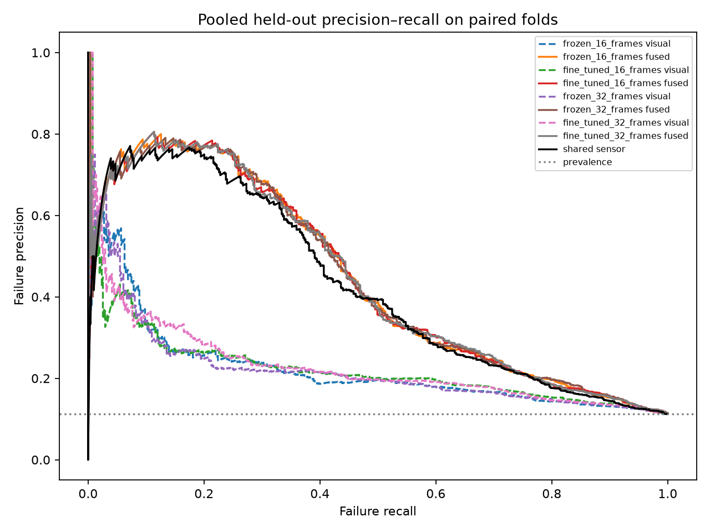

# Why higher image AP did not produce higher pooled fusion AP

Completed 22 October 2026. This is an addendum to the existing [fine-tuning diagnosis](reused/FINE_TUNING_DIAGNOSTIC_REPORT.md), not a rerun of that task. The original study is `00_experiments/visual_backbone_one_day/run_01_two_epoch_finetuning/`. Only its sensor fits, calibrators and F2 stackers are used.

**Conclusion:** image predictions changed in both helpful and harmful directions. Many image ranking improvements do carry into fusion, but losses elsewhere offset them. Gains are inconsistent on sensor mistakes, between inner OOF banks and assessment, and between pooled and mean-fold aggregation. The small observed pooled AP differences remain compatible with recording-sampling uncertainty. **The causal mechanism remains unresolved.**

## Work reused and work added

[WORK_INVENTORY.md](WORK_INVENTORY.md) records already complete, partial, running and missing work before computation. No equivalent job was running. Fit completion, leakage, gradient/update records, model replay, aggregate metrics, tied-score AP accounting, existing bootstrap intervals, reliability plots and fusion arithmetic were reused. No completed model-validation suite or plot generation was repeated.

New work consists of cross-modality error overlaps by truth class; true-label log-loss changes and their relation to sensor errors; failure rank-direction summaries and explicitly keyed examples; raw/calibrated score-distribution summaries; checking saved F2 feature order; four missing exploratory intervals; and this review ZIP. The new intervals reuse the existing 2,000 recording-multiplicity draws and aggregation, without generating new draws.

## 1. What changed in image and fusion predictions?

### Reused results: pooled and mean-fold AP answer different questions

| Recipe | Image pooled AP | Image mean-fold AP | Fusion pooled AP | Fusion mean-fold AP |
|---|---:|---:|---:|---:|
| Frozen16 | 0.221644 | 0.231541 | 0.440680 | 0.450293 |
| Fine-tuned16 | 0.224466 | 0.231442 | 0.437521 | 0.447498 |
| Frozen32 | 0.219427 | 0.225568 | 0.439584 | 0.449010 |
| Fine-tuned32 | 0.230609 | 0.242172 | 0.438566 | 0.449334 |

All numbers use five matched outer folds, 4,530 segments/actions, 509 failures and 148 recordings. AP treats failure as positive. Pooled AP ranks every assessment segment together, including across folds fitted with different models/calibrators. Mean-fold AP averages five separately calculated APs, giving equal weight to each fold.

The 16-frame image improvement is present in pooled AP but not in mean-fold AP. Conversely, 32-frame fusion has slightly higher mean-fold AP after fine-tuning (+0.000324), but lower pooled AP (-0.001017). Neither aggregation should be substituted for the other or chosen because it favours a recipe. This is direct evidence that “better image AP but worse fusion” is not uniform across evaluation summaries. It does not identify calibration as the cause.

Frozen recipes train their classifier for five epochs; fine-tuned recipes train the classifier and final CNN stage for two epochs. All fine-tuning contrasts therefore retain this duration confound. The practical fine-tuned32/frozen16 contrast additionally changes frame count.

Evidence: [pooled, mean and per-fold AP](tables/pooled_mean_fold_and_per_fold_AP_reused.csv), [original metric rows including log loss](reused/tables/assessment_metrics.csv).

### New uncertainty gaps filled, existing intervals reused

Values below are pooled AP differences, left recipe minus right. Brackets are paired recording-cluster percentile 95% intervals.

| Contrast | Image difference [95% interval] | Fusion difference [95% interval] | Interval status |
|---|---|---|---|
| Fine-tuned16 − frozen16 | +0.002823 [-0.033563, +0.037891] | -0.003159 [-0.012573, +0.008052] | Reused; fusion is original primary |
| Fine-tuned32 − frozen32 | +0.011182 [-0.024114, +0.046332] | -0.001017 [-0.009295, +0.009400] | New, exploratory |
| Frozen32 − frozen16 | -0.002217 [-0.011503, +0.006836] | -0.001096 [-0.004113, +0.001809] | Reused, secondary |
| Fine-tuned32 − fine-tuned16 | +0.006143 [-0.004840, +0.017524] | +0.001045 [-0.002396, +0.004465] | Reused, secondary |
| Fine-tuned32 − frozen16 | +0.008966 [-0.027807, +0.045404] | -0.002114 [-0.010889, +0.008343] | New, exploratory; frame count and training change |

Every interval includes zero. Sampling uncertainty can still account for these small observed differences; this does not establish equivalence. The draws condition on the already fitted models and do not quantify seed or retraining variation. Newly added comparisons and secondary intervals are exploratory and unadjusted. All 2,000 original draws were valid. Percentile aggregation follows the original `np.percentile(..., [2.5, 97.5])` rule.

Evidence: [all requested/reused intervals](tables/requested_paired_intervals.csv), [only new intervals](tables/new_exploratory_paired_intervals.csv), [new contrast values per original replicate](tables/missing_contrast_replicates_from_original_draws.csv), [original bootstrap policy](reused/bootstrap_policy.json).

## 2. Do image changes add information beyond the sensor?

### New cross-modality overlap at the existing 0.5 threshold

Rows below show visual-versus-sensor correctness. Counts are separated by truth class, so successes do not conceal missed failures.

| True class | Recipe | Visual correct / sensor wrong | Sensor correct / visual wrong | Both correct | Both wrong |
|---|---|---:|---:|---:|---:|
| Failure (509) | Frozen16 | 0 | 94 | 2 | 413 |
| Failure (509) | Fine-tuned16 | 3 | 95 | 1 | 410 |
| Failure (509) | Frozen32 | 0 | 96 | 0 | 413 |
| Failure (509) | Fine-tuned32 | 3 | 95 | 1 | 410 |
| Success (4,021) | Frozen16 | 31 | 1 | 3,989 | 0 |
| Success (4,021) | Fine-tuned16 | 31 | 0 | 3,990 | 0 |
| Success (4,021) | Frozen32 | 31 | 1 | 3,989 | 0 |
| Success (4,021) | Fine-tuned32 | 31 | 2 | 3,988 | 0 |

Fine-tuning makes three previously sensor-missed failures exceed the visual 0.5 threshold in each frame-count recipe. Most failures remain below the visual threshold, so these counts alone cannot explain AP. Images already classify all 31 sensor-false-positive successes correctly at that threshold before fine-tuning, which also does not imply F2 will necessarily correct those cases.

The CSV includes fusion-versus-sensor overlaps as well. Fusion detects 17 versus 16 sensor-missed failures for frozen16 versus fine-tuned16, and 15 versus 19 for frozen32 versus fine-tuned32. Thus complementarity changes in both directions; “images became useless” is unsupported.

Evidence: [complete cross-modality overlap table](tables/cross_modality_error_overlap_at_0_5.csv). No threshold was tuned.

### Label-aware continuous changes are mixed on sensor mistakes

For actual failures, lower log loss and Brier mean better probabilities, not merely higher arbitrary confidence. The shared sensor detects 96 failures at 0.5 and misses 413.

| Matched comparison | Failure subset | Count | Image mean Brier change | Image mean log-loss change | Fusion mean Brier change | Fusion mean log-loss change |
|---|---|---:|---:|---:|---:|---:|
| Fine-tuned16 − frozen16 | Sensor missed | 413 | -0.002004 | -0.008481 | +0.000849 | +0.001752 |
| Fine-tuned16 − frozen16 | Sensor detected | 96 | -0.001836 | -0.051747 | +0.002554 | +0.004205 |
| Fine-tuned32 − frozen32 | Sensor missed | 413 | -0.001471 | +0.006724 | +0.000751 | +0.003540 |
| Fine-tuned32 − frozen32 | Sensor detected | 96 | -0.016703 | -0.080410 | +0.002663 | +0.003750 |

Negative changes are improvements. At 32 frames, image probability improvements are much stronger among failures the sensor already detects. Among sensor-missed failures, image Brier improves slightly but log loss worsens, showing that different error sensitivities matter. At 16 frames, image probabilities improve on the sensor-missed subset by both measures, yet fusion probabilities worsen on average there. These findings support inconsistent additional utility, not a universal claim of redundancy.

Successes are analysed separately. Image log loss improves on sensor-correct successes but worsens on the 31 sensor-false-positive successes: +0.019206 at 16 frames and +0.013262 at 32 frames. Both success/failure samples and fixed sensor correctness are identical across each comparison. No subgroup AP advantage is inferred by comparing subsets with different prevalence.

These are descriptive results conditional on the sensor's existing 0.5 decisions. They are not a causal test of sensor dominance or independent subgroup hypotheses.

Evidence: [class/sensor summaries](tables/label_aware_change_summary_by_truth_and_sensor.csv), [16-frame action-level changes](tables/label_aware_paired_changes_16_frames.csv), [32-frame action-level changes](tables/label_aware_paired_changes_32_frames.csv). Per-action Brier changes are reused from the completed packet; true-label log-loss changes are new.

## 3. What happened to rankings relevant to AP?

AP depends on the full relative ordering, not the number of decisions above 0.5. A true failure's probability can improve while its rank worsens because other examples move more.

New pooled-rank accounting shows:

| Frames | Failures moving up in both image and fusion | Down in both | Image up, fusion down | Image down, fusion up | Other / unchanged combinations |
|---|---:|---:|---:|---:|---:|
| 16 | 228 | 234 | 23 | 23 | 1 |
| 32 | 235 | 237 | 14 | 17 | 6 |

Most image improvements do pass through to improved fusion ranking; opposing changes elsewhere can cancel them. At 16 frames the joint-down group contributes -0.015994 to the global fusion AP change, while the joint-up group contributes +0.012971. At 32 frames those contributions are -0.015540 and +0.014280. Other groups produce the remaining balance. These sums reuse the existing exact AP contributions rather than recomputing them.

Mean/percentile ranks use average positions for equal scores. Existing AP contributions use complete tied-score groups and were already tested to sum exactly to AP. A rank-direction count is not itself an AP contribution: precision at that position also depends on the labels ranked ahead. Contributions are descriptive metric accounting, not causal effects of samples or recordings.

Four explicitly selected failure examples illustrate image pooled-rank improvement with fusion pooled-rank deterioration. They are the two largest image rank displacements per frame-count pair within that direction combination, with stable sample-ID ties. They are not representative or independent statistical evidence.

For example, failure `df8654390a9d6365e94bdc56` (recording `2025-01-09-17-03-05`, segment 45) has visual probability 0.055623 → 0.063889, while fusion probability falls 0.049315 → 0.048124. Its visual pooled percentile rank improves by 0.086313 but its fusion rank worsens by 0.033996.

Another example, `6c6fbc69d4a995087145d737` (32 frames; recording `2025-01-09-17-51-35`, segment 12), improves visual probability 0.110882 → 0.151254 and fusion probability 0.876388 → 0.886960. Its visual rank improves substantially, but fusion falls one position in the pooled ranking. Here true-label log loss improves while relative ranking deteriorates. This illustrates why increasing the right probability need not improve AP.

Evidence: [pooled and within-fold rank-direction cells](tables/failure_rank_direction_combinations.csv), [four pooled-AP examples](tables/selected_pooled_AP_rank_examples.csv). An additional stratified set of within-fold illustrations, including the saved F2 terms, is in [keyed within-fold examples](tables/selected_keyed_failure_rank_examples.csv).

The original precision–recall plot is reused unchanged. The fusion curves largely overlap and do not exhibit a clear uniform separation. Reused fixed-budget diagnostics show fewer additional sensor-missed failures near the top 10% after fine-tuning, but mixed or slightly improved coverage at 20%. Neither the plot nor the fixed-budget slices proves significance.

Evidence: [existing fixed-budget complementarity](reused/tables/fixed_budget_complementarity.csv), [existing action contributions](reused/tables/action_AP_contributions.csv), [existing recording contributions](reused/tables/recording_AP_contributions.csv).

## 4. Calibration and actual F2 behaviour

All 20 saved F2 feature orders are `['p_visual', 'p_sensor']`. The model is `sigmoid(a_visual * p_visual + a_sensor * p_sensor + intercept)`, with no extra F2 calibrator. The existing arithmetic replay checks cover these same final artifact identities and were reused rather than rerun.

All visual calibrator slopes are positive. Existing checks establish that calibration preserves visual ranking and AP within every individual fitted branch. However, distinct fold-specific calibrators change the probability values consumed by F2 and the relative comparability of scores across folds. Pooled versus mean-fold differences above illustrate the relevance of this distinction; they do not isolate a calibration effect.

The new distribution table gives raw visual/sensor logit and calibrated visual/sensor/fusion mean, standard deviation, 5th/50th/95th percentiles, extrema and tied-score support, by fold, pooled scope and truth class. Raw visual logits arose from class-weighted training and must not be interpreted directly as calibrated failure probabilities. Existing reliability and aggregate Brier/log-loss summaries are retained. Brier is an overall probability score, not a pure calibration statistic.

The image F2 coefficient decreases in outer folds 1, 3 and 5 for both frame-count comparisons and increases in folds 2 and 4. Sensor coefficients and intercepts also change. As one example, fold 1's 32-frame image coefficient changes 3.221563 → 1.964726, sensor coefficient 6.232461 → 6.298573, and intercept changes by +0.144892. Those changes must be read together with the input probabilities.

Existing exact logit accounting separates image-probability changes, coefficient changes, the unchanged sensor input with changed sensor coefficient, and intercept changes. Its symmetric algebraic decomposition reconstructs observed logit differences below 1e-11. It is not a counterfactual swap of stackers or a causal decomposition of AP. No alternative fusion weights or models were created or ranked.

Coefficients and score-term variation are not “trust percentages.” Scale, covariance and jointly fitted coefficients affect their interpretation. The recorded sensor term has greater variation than the image term, but that alone cannot establish causal importance or the marginal value of images.

Evidence: [saved calibration identities and feature order](tables/saved_calibrators_and_F2_feature_order.csv), [raw/calibrated distributions](tables/raw_and_calibrated_score_distributions.csv), [existing coefficient/intercept and input spreads](reused/tables/fusion_coefficients_and_score_spread.csv), [existing exact logit accounting](reused/tables/exact_fusion_logit_change_decomposition.csv), [reliability bins](reused/tables/reliability_bins.csv), [calibration by fit](reused/tables/calibration_by_fit.csv).

## 5. Direct evidence, hypotheses and uncertainty

**Direct observations:** image probabilities improve overall; their added utility on sensor mistakes is mixed; many image rank gains transfer but losses offset them; pooled and mean-fold conclusions differ slightly; image coefficients and score scales change; all requested AP-difference intervals include zero.

The prior OOF result is also reused: 32-frame fine-tuning reduces visual AP in all five inner OOF banks, while outer-assessment visual AP improves in three of five folds. At 16 frames OOF visual AP falls in three of five. This suggests inconsistent branch behaviour across the stages available to the stacker, but does not prove a mechanism. The banks overlap across outer folds and are not five independent replications.

Crucially, inner-OOF branch predictions are held out from branch fitting/calibration, but **F2 was trained on those rows**. Fusion performance on the OOF bank would be fusion training performance, not independent fusion validation. No new claim of independent OOF fusion performance is made here.

**Unresolved hypotheses:** incomplete optimisation after two epochs, differences in branch training size between inner and outer fits, seed variation, changes in feature distributions, calibration transfer, or limited complementary image information. Existing first-two-epoch training-loss patterns motivate investigation but cannot identify underfitting or overfitting without appropriate held-out monitoring. The five-versus-two epoch comparison prevents isolating adaptation from training duration. No new image/label review or feature-drift measurement occurred.

**Uncertainty:** all requested intervals include zero, including newly added fine-tuned32/frozen32 fusion [-0.009295, +0.009400] and fine-tuned32/frozen16 fusion [-0.010889, +0.008343]. The mechanism need not be forced to explain a reliably established disadvantage because such a disadvantage has not been established. The study has one seed family and previously exposed assessment data; recording-bootstrap intervals do not cover training randomness.

## Provenance, validation reuse and stopping point

The inventory and [input SHA256 manifest](provenance/input_manifest.json) identify the source paths. Current assessment predictions match the final evaluation source hashes; reused diagnostic artifacts match the earlier output manifest; saved calibrators/F2 identities match the earlier consumed-input hashes. There are 82 distinct matches to previously checked evidence. The source evaluation implementation matches its recorded hash, and original bootstrap draw/order hashes match the original bootstrap policy. Original sensors are not replaced with encoder-study sensors.

Only the new weighted-AP shortcut was tested: 12 tiny synthetic tied-score/zero-weight cases matched sklearn. This is not a repeat of the original bootstrap or model test suite. [New-check receipt](checks/missing_diagnostics_checks.json) records no model suites repeated, no plots regenerated, no AP attribution recomputed and no alternatives evaluated. [Reused-check evidence](reused/checks/SELF_REVIEW.md) explains the original scope and limitations. [Preservation/package receipt](checks/packet_verification.json) covers the final handoff.

The review ZIP includes this report, new tables/scripts, selected unchanged prior evidence, and directly identified assessment predictions, saved numerical F2/calibrator records and original bootstrap multiplicities. Large models, features and raw data are excluded. Reused original reports remain verbatim; their historical relative references may require the repository, while this report's packet links point to included evidence.

Review remains a self-review; no independent scientific reviewer was available or claimed. Existing scientific files, both earlier output packets and unrelated dirty-tree changes are preserved. No training, refitting, threshold tuning, new corruptions, raw-image inference, installation or scheduling occurred. The addendum finishes within the 30-minute window.

The appropriate next step is to review the evidence and decide whether a separately pre-specified control is justified. This task stops at the diagnostic explanation and review package, with no follow-up experiment launched.
