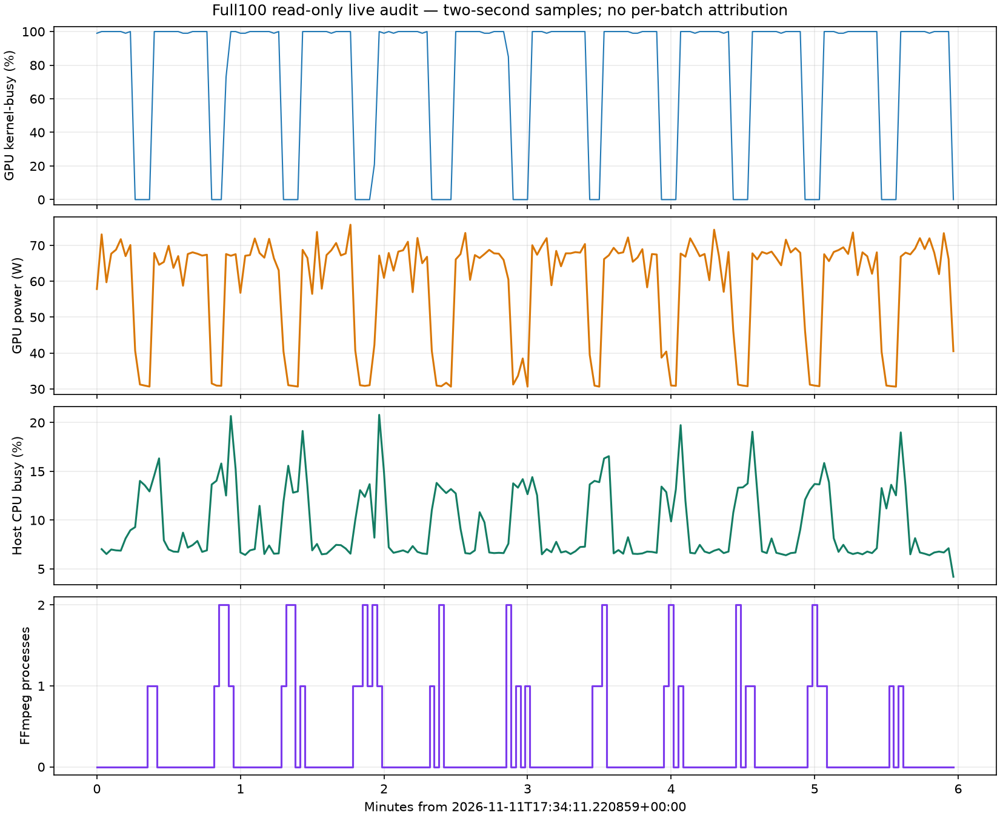

# Full100 live training performance diagnostic

Audit date: 2026-11-11. Study: `matched_cnn_20_100_f2_20261111`.

**Leave the active Full100 process and its existing queue unchanged.** The evidence supports bounded CPU-only documentation and saved-prediction checks alongside it. For a separately versioned future implementation, test a deeper bounded episode queue and modestly more loader workers. There is evidence of intermittent GPU inactivity and a structural prefetch limitation, but no measured loader-optimization speedup. A second GPU training job is not admitted.

## Measurement scope and provenance

Collected **180 samples at two-second intervals over six minutes**, from **2026-11-11T17:34:11.220859+00:00** to **2026-11-11T17:40:09.220984+00:00** (18:34–18:40 CET; first-to-last sample span 358.0 seconds). The collector exited normally after 360 seconds. Full100 PID **29074**, creation time **1794353606.37**, was verified throughout. Training remained in epoch **11**, with **10/100 epochs committed**. Coarse receipts advanced from 240 to 320 episodes; those receipts update every 80 episodes, so this is not an exact six-minute episode throughput measurement.

Methods: read-only `nvidia-smi` queries; `/proc`/psutil CPU, process, I/O and memory counters; cgroup limits; existing training journals and source inspection. No profiler attached, new CUDA context, model/checkpoint load, video decode benchmark, training, restart, pause, active configuration edit, cache deletion, commit or push. Only new diagnostic files were written. Existing automatic reporting continued independently.

Evidence directory: [audit_20261111_01](16_performance_diagnostics/audit_20261111_01/). It contains the collector/analyzer, raw samples, start/end journal snapshots, source hashes, software/command/Git provenance, summary, figure, hardware supplement and output manifest. Git HEAD at collection was `e32ec43aef69cc58adff0ea91e508308041598c5`; the pre-existing working tree was dirty from live reports. Frozen implementation hashes matched. The diagnostic Python files are outside the study's frozen `src/` and `scripts/` directories.

## 1. GPU compute, memory and power

| Measurement | Observed value |
|---|---|
| Device | One Tesla T4; 16,384 MiB reported total |
| Kernel-busy utilization | Mean **74.76%**; median 100.0%; range 0–100% |
| Samples at 0% / at least 95% | **24.4% / 73.9%** |
| Driver-reported memory used | 5589–5589 MiB (5.46 GiB mean) |
| Driver-reported memory free | **10341–10341 MiB** (10.10 GiB minimum) |
| Driver-reserved memory, separate spot query | 455 MiB; this is not PyTorch's allocator reservation |
| PyTorch peak allocated, completed epochs | **5.109 GiB**, read from existing history |
| PyTorch live allocated / live reserved | **Not observable in existing telemetry.** No invasive inspection was attempted. |
| Power draw | Mean 58.85 W; range 30.65–75.76 W; configured limit 70 W |
| Temperature / SM clock | 62–67 °C / 585–1590 MHz |

NVIDIA's utilization counter reports the fraction of its sampling period with one or more kernels executing. It is not SM occupancy, arithmetic throughput, or the percentage of capacity available to a second job. Driver memory usage also differs from PyTorch tensor allocation and caching-allocator reservation. See [NVIDIA's counter definitions](https://docs.nvidia.com/deploy/nvidia-smi/index.html) and [PyTorch memory accounting](https://docs.pytorch.org/docs/stable/notes/cuda.html#memory-management). Free memory must be read directly: driver reservation means total minus used does not equal usable free memory.

The sample series contains **12 zero-utilization runs**, approximately 2–10 seconds long by two-second sample counting. These are coarse inactivity indicators with boundary/aliasing uncertainty, not exact inter-batch timings. The previous complete training phase, epoch 10, independently averaged **72.60%** utilization. The whole-controller mean near 69% also includes validation, initialization and checkpoint work and must not be treated as the training-only value.

The saved spot queries show software power limiting inactive at 17:41:21 UTC and active at 17:42:14 UTC during 100% kernel-busy utilization; thermal slowdown was inactive in both. See `hardware_supplement.json` and `power_spot_second.json` in the evidence directory. These snapshots do not establish a time-averaged throttle rate or justify changing power limits. No GPU settings were changed.

## 2. CPU, workers, memory pressure and disk

The VM exposes **16 logical CPUs / 16 reported physical cores**. Trainer and loader affinity includes CPUs 0–15. All inspected cgroup ancestors have unlimited CPU quota (`cpu.max=max 100000` where present); the root effective cpuset is 0–15. No quota throttling was reported. VM host scheduling beyond the guest remains outside this audit.

Host busy utilization, excluding idle and I/O wait, averaged **9.55%** of the 16-CPU machine, range 4.20–20.79% (1.53 CPU cores on average). Mean I/O wait was **0.1250%**; mean steal **0.0040%**. These include the OS, watcher and lightweight audit activity, not just training.

| CPU | Mean busy |
|---|---|
| 0 | 6.69% |
| 1 | 8.23% |
| 2 | 6.93% |
| 3 | 9.40% |
| 4 | 4.68% |
| 5 | 3.70% |
| 6 | 7.47% |
| 7 | 5.49% |
| 8 | 5.46% |
| 9 | 4.95% |
| 10 | 3.39% |
| 11 | 3.71% |
| 12 | 11.69% |
| 13 | 6.38% |
| 14 | 2.37% |
| 15 | 62.32% |

Process CPU percentages below use **100% = one full core** and therefore must not be compared directly with host percentages. Reaped-child time captures short-lived subprocess CPU that ordinary process snapshots miss. For loader workers it is predominantly FFmpeg; trainer children also include telemetry commands. Do not add a separately sampled FFmpeg CPU figure to the worker child accounting.

| Process | Own CPU | Reaped-child CPU | RSS GiB at final sample | OS threads |
|---|---|---|---|---|
| 29074 (python) | 77.44% | 1.80% | 4.216 | 18 |
| 29144 (python) | 0.00% | 0.00% | 0.012 | 1 |
| 1444481 (pt_data_worker) | 15.91% | 15.98% | 0.949 | 7 |
| 1444489 (pt_data_worker) | 15.43% | 15.69% | 0.987 | 7 |

There were **exactly two live `pt_data_worker` processes** throughout. The extra one-thread Python child is multiprocessing infrastructure, not a third loader. Sampled FFmpeg concurrency ranged 0–2; 48 distinct decoder PIDs were captured. Short-lived decoders between samples can be missed. FFmpeg processes had 16, 18, 21, 22 total OS threads despite the **one-thread decoder setting**; total thread count does not measure actively decoding threads. A separate bounded thread-inspection window found no FFmpeg child and is recorded honestly as such in its evidence file.

The sampler itself used 0.58% of one CPU core, plus 1.78% for its reaped children (primarily `nvidia-smi`). Its reads/writes and those of concurrent inspection are included in host counters. No zero-overhead claim is made.

| RAM / I/O measurement | Observation |
|---|---|
| Host RAM | 62.73 GiB total; **49.64–51.94 GiB available** |
| RAM used | 10.78–13.09 GiB; summed process RSS would double-count shared pages |
| Swap use / movement | 0 bytes used; 0 bytes in / 0 bytes out |
| Memory pressure stall | some 0.00000%; full 0.00000% |
| Physical disk (`sda`, whole device only) | Read **0.00059 MiB/s**, write **0.161 MiB/s**; busy **0.974%** |
| Read / write service-time proxy | 1.2 / 1.851 ms per completed request; guest block counters, not application latency |
| I/O pressure stall | some 0.71438%; full 0.70843% |
| Study disk free | **31.55–31.55 GiB**; required reserve 20 GiB |

The study filesystem is ext4 on `/dev/sda1`. Physical disk traffic is low; repeated reads can be served from the page cache. **There is no evidence of disk bandwidth saturation or memory-pressure limitation in this warm-cache training window.** This does not establish cold-cache performance, exclude occasional later I/O stalls, or guarantee no contention from a new workload.

## 3. Actual data pipeline and bottleneck assessment

The frozen runtime is: workers **2**, prefetch **1 per worker**, `persistent_workers=False`, `pin_memory=True`, spawn start method, `batch_size=None`. The trainer gathers eight episodes explicitly before each optimizer update. Model-side PyTorch CPU operations use two threads. References: `src/matched_vifailback/training.py:99–104,145–154`, `model_runtime.py:35`, protocol resource fields.

Each episode uses 16 selected frames from each of three cameras. Cameras are synchronously decoded/preprocessed **sequentially within an episode**; the two workers can overlap separate episodes. FFmpeg uses CPU decoding (`-hwaccel none`), `-threads 1` before `-i`, and `-filter_threads 1`. The selection filter scans the clip and emits the selected frames. RGB hashes are verified, then the original PIL bilinear resize/rescale produces the FP32 tensor. There is no decoded-frame cache, seek-based extraction, persistent FFmpeg decoder, or hardware decoding. See `VIFAILBACK/src/vifailback/video.py:33–41` and `visual.py:69–100`.

**The same 48 selected frames are decoded again on every epoch's visit.** Within one optimizer update, however, decoded pixels are retained and reused for the two-pass CNN computation: they are not decoded twice. CNN chunk size is four images. A no-gradient CNN pass obtains episode features; the batched CPU head computes its loss/feature gradients; a second CNN forward plus backward propagates those gradients. Transfers request `non_blocking=True`, but no explicit copy-stream overlap or cross-batch staging is implemented. CPU feature copies and global gradient-norm reductions also synchronize with GPU work (`model_runtime.py:67–109`).

**Supported hypothesis:** two outstanding episode tasks are a shallow queue for an eight-episode update. After the main process finishes collecting a minibatch, at most two new tasks can fill while CNN computation proceeds; obtaining the remaining episodes at the next boundary can expose loader latency. The measured periodic inactivity is consistent with that mechanism. It does **not** prove every gap is a decode wait: CPU head work, synchronization, transfers, Python launch overhead and clipping can contribute.

No per-`next(loader)` wait timer, per-camera decode timer, H2D timing, or per-batch start/end timeline exists. Thus **CPU preprocessing is a plausible exposed latency bottleneck, not a demonstrated machine-wide CPU saturation bottleneck**. Spare CPU percentage alone gives no speedup estimate. The source and counters make a future queue-depth experiment more defensible than blindly multiplying decoder threads.

## 4. Video cost, epoch timing and validation

| Component | Measured basis | Time |
|---|---|---|
| Training phase | Ten completed epochs; includes loading, worker lifecycle, copies, forward/backward, CPU head and optimizer | **94.231 min/epoch**, range 93.899–94.598 |
| Validation | Ten completed epochs, 534 episodes each, including its separate loader lifecycle | **11.747 min/epoch**, 11.085% of combined time |
| Training + validation | Existing `HISTORY.json` | **105.979 min/epoch** |
| Checkpoint commit | Existing `TIMING_EPOCH_*.json`, excluded from the combined timer above | Mean **1.338 s**, maximum 3.435 s |
| Complete pixel preparation | Prior admission benchmark, one T episode; **not newly timed in this audit** | **1.692 s/episode**, includes three decodes, hashing, preprocessing and tensor assembly |
| Cached-pixel CNN/head training | Same prior one-episode benchmark, different batching from production | **2.615 s/episode** |
| Cached-pixel inference | Same prior one-episode benchmark | **0.438 s/episode** |

At production scale, 1,430 training episodes / 179 optimizer updates take about **3.954 s/episode**, while validation averages **1.320 s/episode**. The prior eight-episode admission benchmark took 39.257 s training and 17.096 s inference, including worker startup/shutdown; those small-batch figures overestimate steady-state cost. Pixel preparation, GPU compute and loader concurrency overlap, so these benchmark numbers must not be added to reconstruct the live epoch.

Validation executes real CNN inference, not a deliberately idle GPU phase. It creates a new two-worker loader and evaluates the CPU head once per episode. Existing detailed two-second epoch telemetry covers **training only**; the six-minute audit likewise did not include validation. Controller telemetry aggregates all phases. **Whether validation contains longer GPU idle gaps is unmeasured** and should be instrumented in a future implementation. We can quantify its 11.7-minute wall cost, but cannot reliably divide it into loading versus GPU time. Reducing validation frequency would change model-selection behavior and is outside the proposed loader-only optimization.

## 5. Parallel execution feasibility

The following envelopes are conservative planning estimates, not concurrent-load benchmark results. All proposed CPU tasks should use one process/BLAS thread, small sequential reads, a separate output directory, and `CUDA_VISIBLE_DEVICES=""` in that **new process only**. No such extra fit was launched. A previous nominally CPU-only PyTorch worker created a 102 MiB CUDA context, so GPU exclusion must be explicit (`13_reproducibility/CUDA_CONTEXT_OBSERVATION.json`).

| Task | CPU / GPU | RAM / new disk | I/O and expected effect on Full100 | Scientific / reproducibility constraints |
|---|---|---|---|---|
| A. Documentation | Intermittent <1 core / none | <256 MiB / <10 MiB | Small report reads; negligible effect expected, unbenchmarked | Separate documents; do not overwrite watcher-owned reports |
| B. Verify saved predictions | One CPU/BLAS thread / none | 0.25–1 GiB / <10 MiB | About 18.15 MiB visual prediction JSON plus 25.93 MiB F2 directory; low expected contention | Completed, immutable records only; no refits or score-driven selection; bootstrap can occupy one core |
| C. Prepare Full20 metadata summaries | Intermittent <1 core / none | <256 MiB / <10 MiB | Existing split evidence <1 MiB; low expected contention | Queue/manifests already exist; create a draft/index, never regenerate splits or edit frozen plans |
| D. Another lightweight CPU fit | One CPU/BLAS thread / none | Allow 1–2 GiB / <100 MiB | Existing small feature matrix; low-to-moderate contention plausible but unmeasured | **Not authorized to launch in this audit.** Needs a declared scientific purpose, split/seed/output identity; avoid unnecessary repetitions/HPO |
| E. Another GPU CNN fit | Additional decoder workers and CPU threads / same T4 | Several GiB host RAM; roughly 5.5–6 GiB VRAM; at least 256 MiB persistent allowance plus active checkpoint scratch | Shared kernels, memory bandwidth, PCIe, decoding and disk; Full100 slowdown likely during overlapping compute, size unknown | **Not admitted.** Exclusive-GPU protocol and process gate prohibit it; memory fitting is insufficient evidence |

Use small direct readers for B. The existing `study.py evaluate` is **not** a read-only metric command: it verifies larger context, fits F2 when applicable, and writes live outputs. Likewise avoid loading the complete context merely to inspect metadata; it rehashes large feature banks and verifies source artifacts. A–C are safe candidates without modifying Full100, but even for them no quantitative zero-slowdown guarantee is claimed.

## 6. Six optimization options

| Option | Safe with active process unchanged? | Expected benefit and limitations |
|---|---|---|
| 1. Keep current configuration | **Yes** | Known ~106-minute epochs; no optimization gain, preserves verified continuation and queue |
| 2. More loader workers | Future implementation only | Test 2→4 workers with prefetch1 first, then compare queue depth8. May reduce exposed loading; gain unmeasured and extra workers can regress throughput |
| 3. FFmpeg/prefetch changes | Future implementation only | Prioritize bounded episode prefetch. Keep decoder/filter threads1 initially. Camera concurrency, decoder reuse or threading changes require separate frame-equivalence and throughput checks |
| 4. Deterministic bounded caching | Future implementation only | Bounded RAM staging may help; arbitrary small cross-epoch caches may have poor hit rates. A whole-cohort disk cache is not feasible under current admission |
| 5. Safe CPU-only work | **Yes, A–C within bounded envelopes** | Improves research work completed per day, not measured CNN speed; verify saved records rather than reprocessing videos |
| 6. Additional GPU job | **No under current admission** | No measured aggregate throughput gain; likely resource contention and potential next-fit gate failure. Would require separate authorization and controlled admission after protecting the current job |

**Quantitative scenario, not a speedup prediction:** epoch 10's training-only kernel-busy fraction was 72.60%. If kernel work/clocks stay unchanged and an optimization removes half of the apparent non-kernel wall time, with validation unchanged, the illustrative epoch becomes **93.1 minutes** (~1.14× throughput). Removing all of it would give **80.2 minutes** (~1.32×). This latter ~24.4% wall-time reduction is an idealized ceiling within that simplified fixed-work model, **not an attainable bound established by profiling**. Some inactivity is unavoidable synchronization or CPU computation, samples alias short work, and altered scheduling can change clocks. Real benefit may be zero or negative. No worker/decoder/cache-specific percentage can honestly be inferred yet.

Storage admission already budgets the 36 queued Full20 fits (~9 GiB persistent allowance), plus scratch and reporting, with projected final free space only **20.934 GiB**. Today's ~31.6 GiB free is not an uncommitted cache budget. One FP32 episode is **225 MiB**; eight held by the trainer cost 1.758 GiB. Two existing prefetched episodes add 450 MiB. A future 4-worker ×2-prefetch queue would hold up to eight more episodes (1.758 GiB), before worker imports, copies and temporary arrays; trainer plus queue tensor storage alone is ~3.516 GiB. Current host RAM and ~29.8 GiB `/dev/shm` capacity permit testing such a bound later, not skipping measurement.

A full T+V cache of selected native 640×480 RGB uint8 frames would require **80.91 GiB**; processed 640×640 FP32 tensors require **431.54 GiB**. A small 16-episode cache needs 675 MiB native RGB or 3.516 GiB FP32, but shuffled-epoch reuse must be measured. Cached CNN **features** cannot replace live Full100 features because backbone weights change each update.

## 7. Recommended future configuration and acceptance requirements

Create a separate versioned implementation and preserve the current queue. Proposed controlled comparisons: baseline **workers2/prefetch1**, then **workers4/prefetch1**, followed by queue-depth-eight candidates **workers4/prefetch2** and, if useful, **workers2/prefetch4**. This separates extra CPU parallelism from queue depth. These are candidates, not an approved production replacement. Keep spawn, ordered delivery, pinned memory, decoder/filter threads1, frame chunk4, FP32, eight-episode optimizer batches and the CPU head semantics unchanged. Keep persistent workers disabled until loader reuse across epochs/phases is deliberately designed: toggling the flag alone cannot help when each loader is constructed and discarded anew.

Before a future acceptance decision, measure loader wait, decode/preprocess, H2D, CPU head/optimizer, CUDA compute, worker startup and validation separately, using bounded isolated tests with a declared overhead. Record RAM/pinned/shared-memory peaks, physical and logical I/O, exact frame/tensor hashes, epoch throughput and deterministic order. Select the smallest worker/prefetch configuration that measurably improves whole-epoch throughput while meeting resource and numerical constraints. Do not run this GPU test alongside the active job.

The current implementation hash covers **every study `src/**/*.py` and direct `scripts/*.py`** (`common.py:121–123`) and is checked before **each fit** (`controller.py:128–129`). Even an edit intended only for future Full20, or a new helper in those frozen paths, can stop the existing queue after Full100. Do not edit those files or bypass the hash checks.

If an active-run migration is ever explicitly authorized, all of the following are required:

1. Use the committed `RECOVERY_POINTER.json` and verify slot SHA256, fit identity and completed epoch. Preserve both rolling slots and historical receipts. `BEST_MODEL.pt` is insufficient continuation state.
2. Restore current model parameters/buffers, AdamW moments and step counts, scheduler phase, Python/NumPy/CPU/CUDA RNG, full history, selected-best metadata/payload and initial identity. Preserve the 100-epoch budget and cosine100 schedule.
3. Resume from the committed epoch boundary; the present recovery design replays any incomplete epoch. It does not support exact arbitrary-minibatch continuation. The current pointer was epoch10 throughout this audit; any future action must inspect the then-current pointer.
4. Preserve episode permutation/order, minibatch boundaries including the last partial batch, 48 frame identities/camera order, original preprocessing, fixed normalization, FP32 operations, chunk4 recomputation, CPU dropout RNG, clipping and optimizer update semantics. Keep the loader generator separate from the model RNG.
5. Require bitwise-identical decoded/preprocessed tensors and complete ordered batches for a pure loader change. Verify next-step loss, gradients, model and optimizer tensors, scheduler, RNG and validation outputs against the unchanged implementation, including resumed execution. Any accepted numerical tolerance needs a prospective rationale and separate experiment identity; old recomputation-vs-reference tolerances do not authorize changed pixels.
6. Record a new implementation/protocol identity and explicit lineage to the preserved source checkpoint. No silent alteration of the frozen run or replacement of its receipts. Re-admit storage, memory, throughput and queue handling separately.

References for recovery: `training.py:46–72,287–329`; for exclusive GPU admission: protocol resources and `resources.py:94–111`. No migration was performed or requested by this audit.

## 8. Decision and remaining uncertainty

Full100 should remain unchanged. A–C can make useful progress concurrently with bounded CPU-only resources. The most credible future performance target is the episode queue and loading overlap, supported by source structure and measured inactivity; the precise loading fraction and speedup remain unknown. Validation costs are measured, but its utilization trace and live PyTorch allocator statistics are unavailable. Six minutes of warm-cache training do not establish behavior for every episode or machine condition.

**OPTIMIZE FUTURE DATA LOADING**
